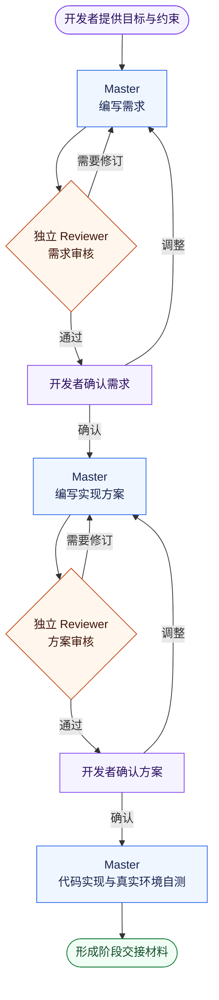
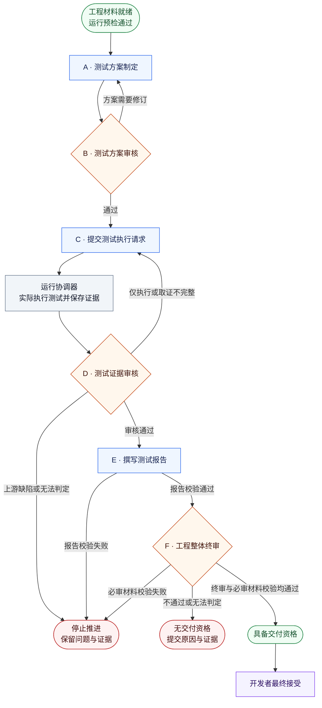

# Aegis

Aegis 是面向 OpenAI Codex 的软件工程治理系统，通过独立智能体分工、对抗审核和可核验证据，管理需求、设计、实现、验证到交付的全过程。

项目由开发者确定目标与授权边界，Master 负责需求、方案和代码，独立角色负责审核与验证。工程判断及其依据保存在项目推理库中，供后续开发继续使用。

## 核心机制

### 职责与权限分离

产出、执行、审核和接受分别承担不同责任。Master 可以修改实现，审核者只能读取被审核材料并提交意见，开发者负责关键取舍与最终接受。Master 无权覆盖独立终审结论。

多智能体流程使用真实创建的独立 agent，分别保留上下文、身份和工作记录。运行协调器负责提供输入、调用角色、检查产物和控制流程；角色之间的交接使用明确的材料，禁止由 Master 在同一上下文中扮演多个角色。

### 对抗审核

审核者围绕需求与证据主动寻找反例、遗漏、矛盾和未经验证的假设。发现问题时，需要说明受影响的结论、依据和缺口；作者负责修订，审核者重新检查。通过与拒绝都必须有可复核的理由。

审核角色在独立上下文中工作，只接收完成本职工作所需的材料。流程调度由协调器控制，审核者提交事实判断，不决定下游处理路径。

### 价值导向与质量、速度的取舍

Aegis 将正确性、可维护性、可验证性和证据完整性作为完成条件，在满足这些条件后优化时间与调用成本。实现从项目的真实约束和不变量出发，每项取舍都应能说明理由。

小步实现、复用仍然有效的材料、按变更影响范围重新验证，可以减少重复工作。降低断言强度、隐藏失败、跳过必要验证或擅自缩小需求，不属于可接受的提速方式。成本与质量发生冲突时，由开发者明确调整范围或接受条件，并重新审核受影响的材料。

### 评价函数分离

评价函数表示一个角色的工作达到什么条件才算合格。Aegis 为不同角色设置不同的工作成功条件：

| 职责 | 工作评价依据 |
| --- | --- |
| Master | 需求与方案是否准确，实现是否满足确认的要求，代码是否达到质量要求 |
| 测试方案制定与审核 | 测试是否覆盖需求、风险和失败路径，能否检验实现中的错误假设 |
| 测试执行 | 是否完整执行批准的测试，是否如实保存结果、失败和原始证据 |
| 证据审核与终审 | 检查是否充分，结论是否得到证据支持，是否明确指出未解决的问题 |
| 报告撰写 | 是否准确整理已有结果，是否保留失败、限制和证据来源 |

测试充分执行并发现代码缺陷，测试工作仍然可以完成；测试全部显示通过，但存在漏测或证据缺失，测试工作仍不合格。审核者给出有充分依据的拒绝结论，同样完成了审核职责。

这种分离使测试和审核无需以代码通过来证明自身工作成功，减少实现者、验证者共同维护既有结论的动机。代码是否具备交付资格，由完整证据与终审决定。

### 项目推理库与证据

推理库保存项目事实、约束、设计取舍、反例，以及支持或推翻结论的证据。每项判断都需要明确来源、适用范围和有效状态；条件变化后，相关判断需要重新检查。

后续 agent 通过项目材料重建决策背景。聊天中的隐含信息不能作为阶段完成或恢复运行的唯一依据。

## 项目结构与推理库

新项目的基础结构由 Master 在开发者授权后创建，包括初始为空的 `code/`、推理库目录和项目配置。接入已有项目时，Master 先检查并复用现有材料，补全缺失部分前取得授权，不清空已有代码或推理库。

以下结构属于受 Aegis 治理的业务项目：

```text
<project_root>/
├── code/                                    # 业务工程；源码、测试和构建文件按项目自身规范组织
├── .aegis/                                  # 项目推理库的文件材料
│   └── reasoning_ledger/                    # 本项目的推理库文件实例
│       ├── README.md                        # 推理库的存储方式、事实版本与索引约定
│       ├── migrations/                      # 数据库结构初始化与迁移材料
│       │   └── 003_reasoning_authority_integrity.sql
│       │                                    # 当前数据库结构的初始化 SQL
│       ├── exports/                         # 导出的推理上下文包与快照，供交接和复核
│       └── artifacts/                       # 可追溯的项目知识与依据文件
│           ├── requirements/                # 需求与约束材料
│           ├── facts/                       # 项目事实材料
│           ├── rules/                       # 项目规则及其依据
│           ├── claims/                      # 需要证据支持的工程主张
│           ├── evidence/                    # 支持或反驳项目判断的证据
│           └── reviews/                     # 项目知识与治理材料的审核记录
└── config/                                  # 项目级配置
    └── reasoning_ledger.json                # 项目身份、数据库连接引用、存储结构与证据位置
```

推理库由文件材料和数据库共同组成。PostgreSQL 保存结构化事实、版本、关系与事件，pgvector 提供可重建的语义索引。Master 创建目录后，还需按授权完成数据库配置、初始化和可用性检查。

运行状态、角色线程登记、检查点、原始响应、TraceRelay 日志和本轮执行证据保存在项目外的运行目录。需要长期保留为项目知识的证据，经登记后纳入推理库。

### 推理库的完善与合并

推理库随需求澄清、设计取舍、实验和审核持续完善。初期允许存在知识缺口，但应区分已确认事实、未验证假设和失效判断，保留各自的来源与状态。

同一项目的推理库可以合并。合并必须保留事实来源、版本、证据与失效状态，识别并处理相互冲突的判断；同时必须提供能代表项目实际运行条件的真实环境，对受合并影响的结论开展实验验证，保存实验条件、结果和原始证据。

真实环境应具备实验所需的依赖、数据、接口、权限和资源条件。缺少环境或尚未完成实验时，受影响的结论须保持待验证状态。文件合并成功、文本无冲突或静态检查通过，均不足以确认合并后的项目知识有效。

## 两阶段工作流程

第一阶段负责形成实现，第二阶段负责独立验证与交付判断。两阶段通过需求、方案、代码、自测材料和推理上下文交接，可以组合使用，也可以单独使用。

下列两图采用相同画法：矩形表示工作，菱形表示审核，圆角节点表示输入或阶段结果。箭头表示受控交接与处理顺序，不表示 agent 之间自由通信。

### 第一阶段：需求、方案与实现

Master 直接与开发者沟通，编写需求和实现方案，经独立 Reviewer 审核及开发者确认后实施代码与自测。



需求审核与方案审核可以由同一个独立 Reviewer 承担。需求、方案及其确认记录固定后，Master 才进入实现；实现中发现原有前提不成立时，返回相应的审核与确认环节。交接材料记录完成范围、自测结果和仍未解决的问题。

### 第二阶段：独立测试、证据审核与终审

第二阶段接收已准备好的工程材料，并在运行前固定本轮输入。A 至 F 各由独立 agent 承担，运行协调器负责调度、实际执行测试和保存证据。



测试执行完成可以包含失败结果。D 检查测试是否充分、执行是否符合方案、结果是否有证据；代码质量与整体交付资格继续交由 F 审核。

发现需求或实现方案缺陷时，结束本轮并返回第一阶段处理；D 发现测试方案缺陷时，结束本轮，在新运行中重新制定并审核测试方案。仅有执行或取证不足、且没有更高层缺陷时，才在本轮补充执行。

运行中固定的材料发生变化时，本轮终止。后续修订通过新运行验证，原有失败结论和证据保留。终审未通过时，Master 核对结论及证据后提交开发者，不得改写为通过。

## Agent 角色与职责

| 角色 | 主要职责 | 权限边界 |
| --- | --- | --- |
| Master | 理解目标，编写需求与方案，直接实现代码、自测并维护推理库；准备交接材料 | 依照确认的范围工作；重大变更须重新确认；不能替代独立终审 |
| Master Reviewer | 独立审核需求与方案，检查歧义、遗漏、冲突、可行性及验证条件 | 只提交审核意见，不修改被审核文档 |
| A：测试方案制定者 | 根据需求、方案、代码和项目约束设计测试，覆盖正常行为、边界与失败路径 | 负责测试设计，不承担代码实现或测试结果批准 |
| B：测试方案审核者 | 检查测试覆盖、有效性与可执行性 | 独立判断方案，不代替 A 修订方案 |
| C：测试执行请求作者 | 根据批准方案形成执行请求，组织执行材料与证据交接 | 实际命令由协调器执行；不得擅自改变测试范围或美化失败 |
| D：测试证据审核者 | 核查测试方案、执行过程与结果的对应关系，识别证据缺口和上游缺陷 | 只报告事实判断，不修改代码、方案或原始证据 |
| E：测试报告撰写者 | 基于已审核证据整理结果、失败、限制和证据索引 | 不重跑测试，不新增缺少证据的结论 |
| F：最终审核者 | 综合审查需求、方案、代码、测试、推理材料和治理记录，给出终审结论 | 结论必须有证据；最终接受仍由开发者决定 |

开发者是目标、授权与接受决策的责任人。运行协调器是执行流程规则的程序，不属于 agent。推理库为各角色提供可追查的项目依据。

## 独立使用与机制组合

两阶段具有独立的工作范围：

| 使用方式 | 必要输入与得到的结果 |
| --- | --- |
| 仅使用第一阶段 | 从目标与约束形成经确认的需求、方案、代码和自测材料；结果停留在实现与自测完成状态 |
| 仅使用第二阶段 | 提供已确认的需求、方案、待验证代码、推理上下文及相应运行条件；获得独立测试证据、报告与终审结论 |
| 连续使用两阶段 | 第一阶段产物作为第二阶段输入，完成从目标到交付判断的治理流程 |

Aegis 支持按职责单独使用原子机制，例如 Reviewer 独立审核、对抗质询、测试方案审核或测试证据审核。采用某一机制时，需要明确其输入、角色权限、判断标准和输出证据；独立审核仍须使用真实独立 agent。

单独使用机制得到的结论只覆盖其审核范围。完整运行器仍有固定的输入与依赖检查，机制裁剪需要同步调整对应的角色约束和运行校验；当前尚无统一的模块启停入口。

## 外部项目与运行条件

完整使用涉及两个配套项目和一个代码完整性组件：

| 项目 | 在 Aegis 中的用途 |
| --- | --- |
| [TraceRelay](https://github.com/rain-123-bow/TraceRelay.git) | 保存受管 agent 交互与运行痕迹，提供可独立核验的过程证据，支撑 agent 行为证据审核 |
| [addyosmani/agent-skills](https://github.com/addyosmani/agent-skills) | 提供需求与计划、编码、调试、测试、代码审查等工程技能，供 Master 按任务选用；Aegis 的专用角色技能保存在本仓库 |
| [AegisSealCore](https://github.com/rain-123-bow/AegisSealCore.git) | 为选定的代码与运行文件提供完整性封印，协助检测治理流程之外的变更，支撑代码安全相关检查 |

TraceRelay 提供记录及完整性核验，记录的语义仍需审核者判断；取证范围限于已接入的受管活动。Aegis 当前绑定固定版本的 TraceRelay，上游默认分支已进入重新设计阶段，使用时必须匹配本仓库的[集成版本](third_party/TraceRelay/README.md)。

Windows x64 使用仓库配套的 AegisSealCore 组件。非 Windows 系统需要从该项目取得源码，自行完成平台适配与编译；当前源码依赖 Windows/MSVC，完整 Aegis 链路也尚未完成跨平台验证。其封印覆盖文件完整性与变更检测，漏洞审计和安全测试仍需独立完成。

### 关闭组件时的影响

TraceRelay 与 AegisSealCore 均可在裁剪后的使用方式中停用。停用时必须同步移除或调整依赖该组件的审核要求、运行检查和证据要求，并明确记录本次未启用的保障。当前完整运行器没有可直接绕过这些依赖的通用开关，单纯删除组件会导致检查失败。

| 停用组件 | 同步调整的流程 | 失去的保障 |
| --- | --- | --- |
| TraceRelay | 依赖工作痕迹的 agent 行为证据审核、会话取证完整性检查及相应报告要求 | 对 agent 实际行为的独立核验能力降低，可能影响交付质量；普通完成声明不足以补齐这部分证据 |
| AegisSealCore | 项目封印、文件完整性核验及依赖封印的准入与终审检查 | 缺少对应的治理外代码变更检测保障 |

关闭组件后的报告只能声明实际执行的检查与获得的证据。任何保留下来的必需检查若无法完成，流程继续保持阻塞。

### 基础环境

当前完整运行链路面向单一受信任开发者的 Windows 本地环境，使用支持所需调用能力的 Codex、Python 运行环境，以及 PostgreSQL 与 pgvector。安装依赖、配置角色、准备推理库和工程材料后，需要通过运行预检。

实际行为验证应在项目的真实目标环境中执行。仅完成静态分析或测试设计时，结果应保留对应范围，不能标记为已完成实际运行验证。

## 当前进度

Aegis 当前为第三代实现（V3），处于工程验证阶段，尚未达到生产就绪。

已完成的受控验证覆盖真实独立 A–F 角色编排、证据绑定、审核拒绝后的重试，以及指定的崩溃中断与恢复路径。推理库已有存储、检索与上下文构建实现，开发环境验证已完成。

这些结果绑定特定源码、配置和受控输入，验证范围集中于流程与证据机制。开放工程任务中的审核质量、长期运行稳定性、生产数据库运维、跨机器安装发布与跨平台支持仍需继续验证。依赖或运行配置变化后，需要重新确认相应能力。

## 反馈与建议

欢迎反馈使用问题、流程缺陷和改进建议。问题反馈请附上使用版本、运行环境、预期行为、实际结果及经过脱敏的复现材料。
